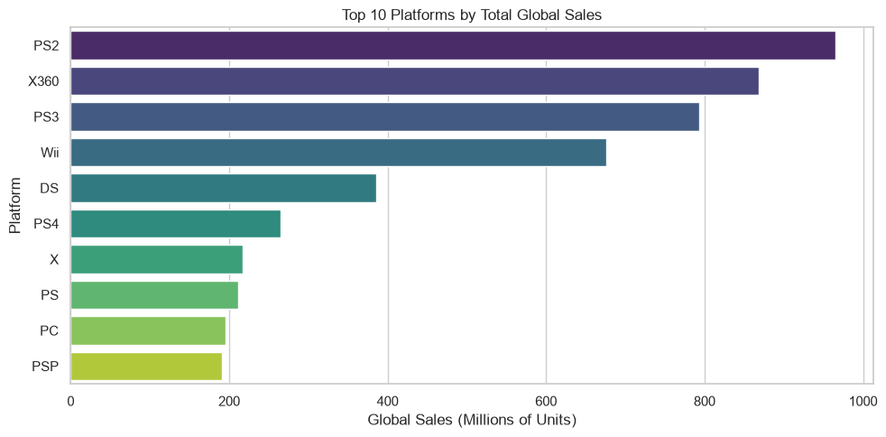
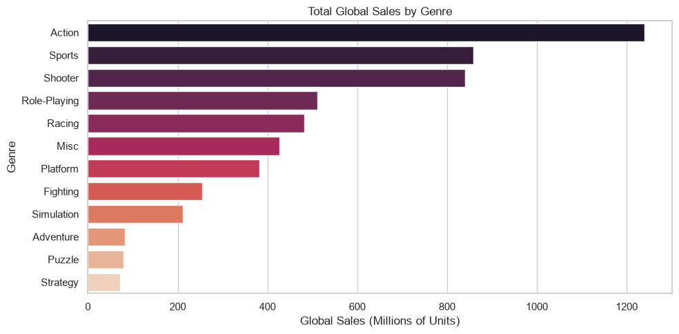
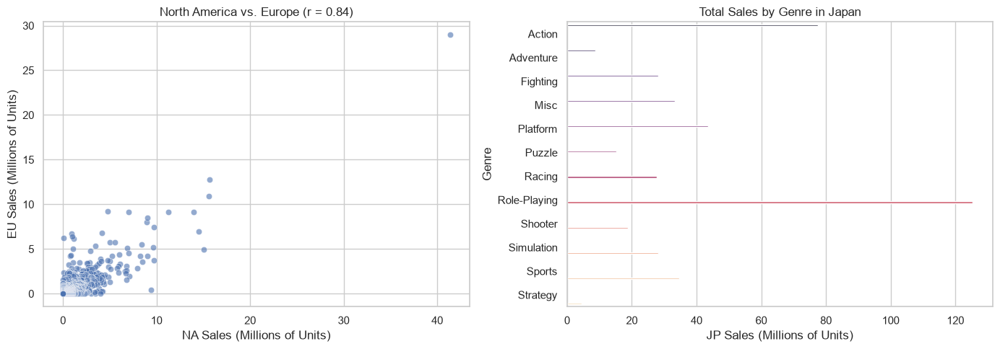
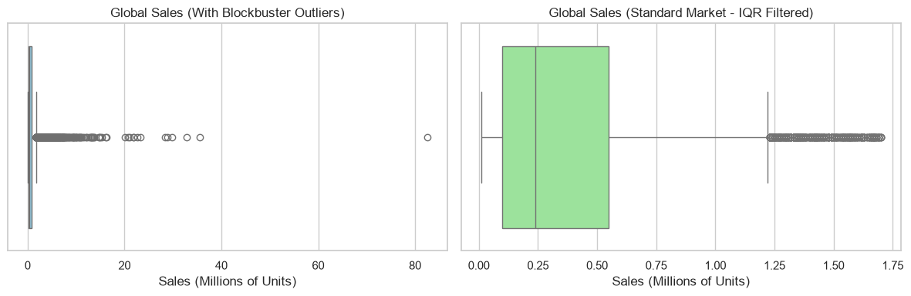
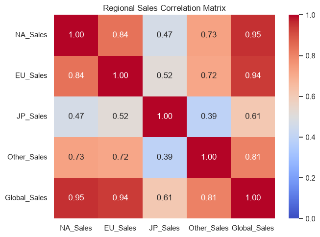
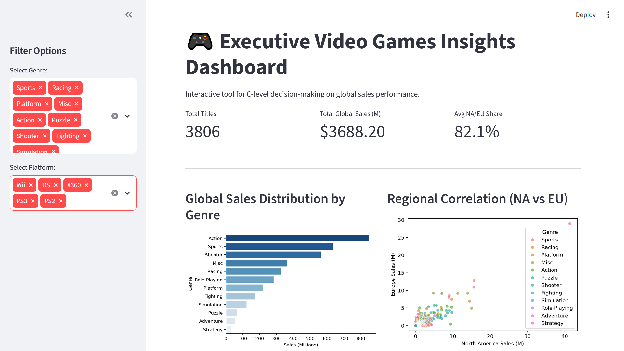

# Informe de Investigación: Análisis Exploratorio del Mercado Global de Videojuegos

| | |
| :--- | :--- |
| **Organización** | IA-P1-BCN |
| **Proyecto** | EDA-VideoGames-Analysis |
| **Autora** | Isbel Hernandez |
| **Dataset** | Dataset histórico de ventas globales de videojuegos (Kaggle / `dato.csv`) |
| **Notebook de análisis** | [`01_eda_videojuegos.ipynb`](01_eda_videojuegos.ipynb) |

---

## 1. Resumen ejecutivo

Este informe documenta el análisis exploratorio (EDA) sobre un dataset histórico de ventas de videojuegos, expresadas en **millones de unidades físicas vendidas** por región. Los resultados principales, verificados sobre el dataset procesado, son:

- El dataset contiene **7,112 registros brutos**; tras el pipeline de depuración se analizan **7,088 títulos** (24 duplicados eliminados, 0 valores nulos).
- El volumen total asciende a **5,440.4 millones de unidades**: Norteamérica concentra el **50.8%**, Europa el **30.4%**, Japón el **8.2%** y otras regiones el **10.6%**.
- Los mercados occidentales (NA + EU) suman de forma agregada el **81.2% del volumen global**; la media por título de la métrica derivada `NA_EU_Share` es **0.83** (79.9% agregado en la categoría Blockbuster).
- La correlación de Pearson entre `NA_Sales` y `EU_Sales` es **r = 0.8382**: fuerte y positiva, aunque moderada por la presencia de blockbusters.
- La distribución de `Global_Sales` está fuertemente sesgada a la derecha (asimetría ≈ 16.1): la **media (0.77 M) casi triplica la mediana (0.29 M)**, y el 9.9% de títulos que superan el límite del rango intercuartílico (≈ 1.71 M) concentran el **54.5% del volumen total**.
- El procesamiento está centralizado en `pipeline.py`, cubierto por **3 pruebas unitarias** y con una reducción de memoria en ejecución del **≈ 52%** (0.87 MB → 0.42 MB).

> **Nota metodológica:** todas las cifras de este informe provienen del notebook [`01_eda_videojuegos.ipynb`](01_eda_videojuegos.ipynb), que consume exclusivamente `run_pipeline()` de `pipeline.py` como fuente única de procesamiento.

---

## 2. Datos y metodología

### 2.1 Origen y alcance

Los datos proceden del [Video Game Sales Dataset (Kaggle)](https://www.kaggle.com/datasets/gregorut/videogamesales) y cubren **17 plataformas y 12 géneros**. Las variables de venta (`NA_Sales`, `EU_Sales`, `JP_Sales`, `Other_Sales`, `Global_Sales`) expresan **unidades físicas acumuladas en millones**; no representan facturación económica, por lo que las conclusiones se formulan en términos de volumen de unidades y no de ingresos.

### 2.2 Pipeline de procesamiento (`pipeline.py`)

El procesamiento está implementado como pipeline reproducible con tres etapas, invocadas desde el notebook mediante `run_pipeline()`:

1. **`load_data()`** — carga del CSV original (`dato.csv`, 7,112 registros).
2. **`clean_data()`** — depuración y optimización:
   - Filtrado de registros sin `Publisher`. *Decisión:* es una salvaguarda preventiva; el dataset actual **no contiene valores nulos** en esta columna, por lo que no elimina registros.
   - Eliminación de duplicados exactos: **24 registros**, con lo que el catálogo analizado pasa de 7,112 a **7,088 títulos**.
   - Normalización del separador decimal (coma → punto) y conversión de las columnas de venta a `float32`.
   - Codificación de `Platform`, `Genre` y `Publisher` como `category`.
3. **`engineer_features()`** — ingeniería de características:
   - `NA_EU_Share` = (`NA_Sales` + `EU_Sales`) / `Global_Sales`, con manejo explícito de la división por cero. Mide el peso occidental en las ventas de cada título; el denominador es la cifra global registrada.
   - `Sales_Category`: segmentación por umbral de negocio mediante `pd.cut` sobre `Global_Sales` con los intervalos `(-∞, 0.1]`, `(0.1, 0.5]`, `(0.5, 2.0]`, `(2.0, +∞)` y etiquetas *Niche*, *Moderate*, *Major* y *Blockbuster*.

### 2.3 Verificación automatizada

La batería de pruebas (`test_pipeline.py`) contiene **3 pruebas unitarias** que validan los contratos del pipeline: eliminación de registros sin `Publisher`, eliminación de duplicados y cálculo correcto de `NA_EU_Share` (incluido el caso de división por cero). Las tres se ejecutan correctamente (`3 passed`).

### 2.4 Optimización de memoria

La combinación de `float32` en las columnas de venta y `category` en las variables textuales reduce la huella en memoria del DataFrame de **0.87 MB a 0.42 MB (≈ 52% de reducción)**, medida en memoria sobre el DataFrame devuelto por el pipeline. *Advertencia:* esta optimización solo se mantiene en memoria; al leer `dato_cleaned.csv` desde disco, pandas recupera los dtypes por defecto y el consumo aparente aumenta.

---

## 3. Limitaciones del dataset

Antes de presentar resultados, conviene explicitar las limitaciones que acotan su interpretación:

- **Dataset histórico sin variable temporal.** No existe columna de año o fecha, por lo que no es posible realizar análisis temporal ni contrastar tendencias recientes. **Los resultados describen el acumulado histórico del catálogo y no deben extrapolarse al mercado actual** (dominado por distribución digital, móvil y free-to-play, ausentes en este dataset).
- **Unidades vendidas, no ingresos.** Al no disponer de precios ni márgenes, el análisis no permite inferir valor económico, rentabilidad ni presupuestos.
- **Inconsistencia interna entre regiones.** En el 53.1% de los registros la suma de las ventas regionales no coincide exactamente con `Global_Sales`, y en 102 casos `NA_Sales + EU_Sales` supera a `Global_Sales`. Por ello, las cuotas occidentales se reportan de forma agregada (más robusta) junto a la media por título, que puede exceder 1 en casos puntuales.
- **Sin identificador de título.** El extracto no incluye el nombre del juego, lo que impide analizar franquicias, editoras de referencia por título o casos concretos.
- **Umbrales de negocio arbitrarios.** Los cortes de `Sales_Category` (0.1 / 0.5 / 2.0 M) son decisiones analíticas documentadas, no estadísticas derivadas de los datos; alterarlos modifica la composición de las categorías.

---

## 4. Resultados del análisis

### 4.1 Plataformas: concentración del volumen histórico en consolas legacy



*Figura 1. Diez principales plataformas por volumen de ventas globales acumulado (millones de unidades), sobre el dataset procesado (7,088 títulos).*

**Resultado observado:** las cuatro plataformas líderes acumulan **3,303.0 M de unidades (60.7% del total)**: PS2 (965.0 M), X360 (868.5 M), PS3 (793.3 M) y Wii (676.2 M). Les siguen DS (385.2 M), PS4 (264.9 M), Xbox (216.9 M), PS (210.8 M), PC (195.4 M) y PSP (190.5 M).

**Interpretación:** el volumen histórico se concentra en un grupo reducido de ecosistemas de sobremesa de los ciclos PS2/X360–PS3/Wii. Un agrupamiento descriptivo por volumen sería:

| Nivel | Volumen acumulado | Plataformas |
| :--- | :--- | :--- |
| Líderes | > 600 M | PS2, X360, PS3, Wii |
| Consolidadas | 150–400 M | DS, PS4, Xbox, PS, PC, PSP, GC |
| Volumen reducido | < 150 M | XOne, GBA, 3DS, WiiU, PSV, DC |

### 4.2 Géneros: Action, Sports y Shooter lideran el catálogo global



*Figura 2. Volumen de ventas globales acumulado por género (millones de unidades), para los 12 géneros del dataset.*

**Resultado observado:** **Action (1,239.3 M)**, **Sports (859.1 M)** y **Shooter (840.7 M)** encabezan el volumen global, seguidos de Role-Playing (511.8 M) y Racing (482.1 M).

**Interpretación:** la demanda agregada se concentra en géneros de gran alcance comercial y ciclos de lanzamiento anualizados; los géneros de nicho (Adventure, Puzzle, Strategy) quedan por debajo de 82 M cada uno.

### 4.3 Comportamiento regional: occidente sincronizado, Japón diferenciado



*Figura 3. Izquierda: dispersión de `NA_Sales` frente a `EU_Sales` con coeficiente de Pearson (r = 0.84). Derecha: volumen de ventas en Japón por género (millones de unidades).*

**Resultados observados:**

- La correlación de Pearson entre `NA_Sales` y `EU_Sales` es **r = 0.8382**, un ajuste lineal fuerte aunque influido por los títulos de mayor volumen.
- La cuota occidental agregada (suma de unidades) es del **81.2%** del volumen global. La métrica por título `NA_EU_Share` presenta una media de **0.83**; en la categoría Blockbuster (582 títulos), media de **0.81** y cuota agregada de **79.9%**.
- En Japón, el género con mayor volumen es **Role-Playing (125.3 M)**, seguido de Action (77.5 M) y Platform (43.6 M); Shooter ocupa un lugar secundario (18.9 M). Las correlaciones de Japón con los mercados occidentales son moderadas: r = 0.47 con NA y r = 0.52 con EU.
- Los géneros líderes en Norteamérica son Action (609.2 M), Sports (473.0 M) y Shooter (462.3 M); en Europa, Action (400.6 M), Shooter (268.8 M) y Sports (254.2 M).

> **Corrección respecto a versiones anteriores del informe:** la afirmación de que el bloque occidental representaba "entre el 65% y el 70% de los ingresos globales" no se sostiene con la definición verificada. Con el denominador `Global_Sales` y sobre el catálogo completo, la cuota agregada NA+EU es del **81.2%** (79.9% agregado en Blockbusters; 80.8% de media por título). Asimismo, la unidad de medida es el **número de unidades vendidas**, no ingresos económicos.

**Interpretación:** la elevada correlación y la cuota compartida son consistentes con un mercado occidental homogéneo que admite estrategias comerciales y de distribución coordinadas entre Norteamérica y Europa. Japón, en cambio, presenta una estructura de demanda diferenciada (liderazgo de Role-Playing, peso reducido de Shooter), lo que sugiere que una entrada en ese mercado se beneficiaría de una adaptación específica del catálogo.

### 4.4 Distribución y outliers: un mercado concentrado en pocos títulos



*Figura 4. Diagramas de caja de `Global_Sales` (millones de unidades). Izquierda: distribución completa con blockbusters. Derecha: mercado estándar tras filtrar los valores por encima del límite del rango intercuartílico (Q3 + 1.5·IQR ≈ 1.71 M).*

**Resultados observados:** la distribución de `Global_Sales` presenta asimetría positiva extrema (≈ 16.1), con media de **0.77 M** frente a mediana de **0.29 M** y un máximo de 82.54 M. El límite superior del IQR (Q3 + 1.5·IQR ≈ **1.71 M**) clasifica como atípicos a **703 títulos (9.9% del catálogo)**, que en conjunto concentran **2,966.6 M de unidades (54.5% del volumen total)**. La categoría Blockbuster (> 2 M) agrupa a 582 títulos (8.2% del catálogo) y el **50.4% del volumen**.

**Interpretación:** el mercado es típicamente de bajo volumen por título, con una cola corta de superventas que domina el agregado. Para estimaciones sobre el título típico es más representativa la mediana (o el dataset filtrado por IQR) que la media, que queda inflada por los atípicos.

### 4.5 Matriz de correlación regional



*Figura 5. Coeficientes de Pearson entre las ventas regionales y `Global_Sales` (dataset procesado).*

**Resultado observado:**

| | NA | EU | JP | Other | Global |
| :--- | :---: | :---: | :---: | :---: | :---: |
| **NA** | 1.00 | 0.84 | 0.47 | 0.73 | 0.95 |
| **EU** | 0.84 | 1.00 | 0.52 | 0.72 | 0.94 |
| **JP** | 0.47 | 0.52 | 1.00 | 0.39 | 0.61 |
| **Other** | 0.73 | 0.72 | 0.39 | 1.00 | 0.81 |
| **Global** | 0.95 | 0.94 | 0.61 | 0.81 | 1.00 |

**Interpretación:** NA y EU se comportan de forma alineada entre sí y dominan la varianza de `Global_Sales` (r ≈ 0.95 y 0.94), mientras que Japón muestra la menor vinculación tanto con occidente como con el volumen global, en línea con la lectura regional de la sección 4.3.

---

## 5. Conclusiones

Cada conclusión distingue el resultado observado de su interpretación analítica:

1. **Mercado occidental integrado.**
   *Resultado:* r(NA, EU) = 0.8382 y cuota agregada NA+EU del 81.2% del volumen global.
   *Interpretación:* los datos son consistentes con una gestión comercial y de distribución coordinada para ambos mercados, con seguimiento conjunto de la métrica `NA_EU_Share`.

2. **Japón como mercado diferenciado.**
   *Resultado:* correlaciones moderadas de Japón con occidente (0.47–0.52) y liderazgo del género Role-Playing (125.3 M, frente a 77.5 M de Action).
   *Interpretación:* replicar en Japón el portafolio orientado a occidente (Action/Shooter/Sports) tiene un respaldo limitado en los datos; el catálogo y la localización requieren adaptación al patrón de demanda japonés.

3. **Concentración del éxito comercial.**
   *Resultado:* el 9.9% de títulos supera el límite IQR (≈ 1.71 M) y concentra el 54.5% del volumen; la mediana (0.29 M) queda muy por debajo de la media (0.77 M).
   *Interpretación:* para análisis de viabilidad de títulos individuales conviene usar la mediana o el mercado estándar (IQR) como referencia, tratando los blockbusters como casos de cola con dinámica propia.

4. **Plataformas legacy como base del histórico.**
   *Resultado:* cuatro plataformas (PS2, X360, PS3, Wii) acumulan el 60.7% del volumen histórico.
   *Interpretación:* el catálogo refleja un mercado de generación anterior; esta concentración es un hecho histórico del dataset y no una proyección de plataformas actuales.

5. **Base de ingeniería reproducible.**
   *Resultado:* pipeline centralizado en `pipeline.py`, 3 pruebas unitarias superadas y reducción de memoria del ≈ 52%.
   *Interpretación:* el procesamiento único y verificado reduce el riesgo de inconsistencias entre notebook, dashboard (`app.py`) y futuras ampliaciones del análisis.

---

## 6. Reproducibilidad

El análisis completo es reproducible desde el repositorio:

```powershell
# 1. Procesar el dataset (genera dato_cleaned.csv)
python pipeline.py

# 2. Ejecutar las pruebas unitarias (3 tests)
python -m pytest test_pipeline.py -v

# 3. Explorar el análisis completo en el notebook
#    Abrir 01_eda_videojuegos.ipynb y ejecutar todas las celdas en orden

# 4. Dashboard interactivo (opcional)
python -m streamlit run app.py
```



*Figura 6. Vista del dashboard interactivo desarrollado en Streamlit (`app.py`). Captura ilustrativa de la herramienta con filtros aplicados; las cifras mostradas corresponden a la sesión de captura y no sustituyen a los valores del informe.*

---

*Documento generado a partir de los resultados del notebook `01_eda_videojuegos.ipynb` (celdas ejecutadas en orden secuencial) y del código fuente de `pipeline.py` y `test_pipeline.py`.*
